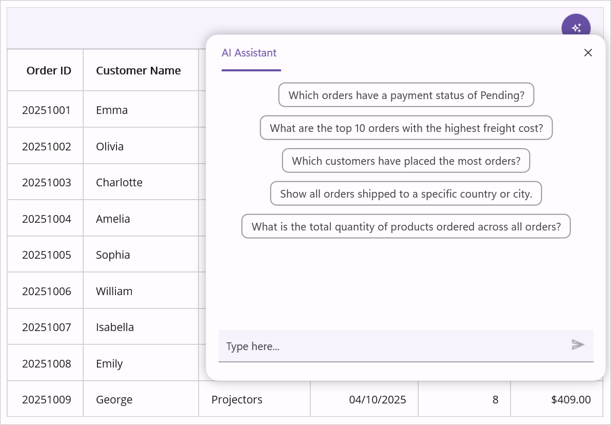

# Getting Started with .NET MAUI Smart DataGrid

## Prerequisites

Before proceeding, ensure the following are set up:

- Install .NET 9 SDK or later.
- Set up a .NET MAUI environment with Visual Studio 2026 (v18.0.0 or later).

## Step 1: Create a New .NET MAUI Project

1. Go to **File > New > Project** and choose the **.NET MAUI App** template.
2. Name the project and choose a location, then click **Next**.
3. Select the .NET framework version and click **Create**.

## Step 2: Install the Syncfusion® MAUI Smart DataGrid NuGet Package

1. In **Solution Explorer**, right-click the project and choose **Manage NuGet Packages**.
2. Search for **Syncfusion.Maui.SmartDataGrid** and install the latest version.
3. Ensure the necessary dependencies are installed correctly and the project is restored.

## Step 3: Register the Handler

`Syncfusion.Maui.Core` NuGet is a dependent package for all Syncfusion® controls of .NET MAUI. In the `MauiProgram.cs` file, register the handler for Syncfusion® core.

```csharp
using Microsoft.Maui;
using Microsoft.Maui.Hosting;
using Microsoft.Maui.Controls.Compatibility;
using Microsoft.Maui.Controls.Hosting;
using Microsoft.Maui.Controls.Xaml;
using Syncfusion.Maui.Core.Hosting;

namespace GettingStarted
{
    public class MauiProgram
    {
        public static MauiApp CreateMauiApp()
        {
            var builder = MauiApp.CreateBuilder();
            builder
                .UseMauiApp<App>()
                .ConfigureFonts(fonts =>
                {
                    fonts.AddFont("OpenSans-Regular.ttf", "OpenSansRegular");
                });

            builder.ConfigureSyncfusionCore();
            return builder.Build();
        }
    }
}
```

## Step 4: Register the AI Service

To configure the AI services, call the `ConfigureSyncfusionAIServices()` method in the `MauiProgram.cs` file.

```csharp
using Microsoft.Maui;
using Microsoft.Maui.Hosting;
using Microsoft.Maui.Controls.Compatibility;
using Microsoft.Maui.Controls.Hosting;
using Microsoft.Maui.Controls.Xaml;
using Syncfusion.Maui.SmartComponents.Hosting;

namespace GettingStarted
{
    public class MauiProgram
    {
        public static MauiApp CreateMauiApp()
        {
            var builder = MauiApp.CreateBuilder();
            builder
                .UseMauiApp<App>()
                .ConfigureFonts(fonts =>
                {
                    fonts.AddFont("OpenSans-Regular.ttf", "OpenSansRegular");
                });

            string key = "<MENTION-YOUR-KEY>";
            Uri azureEndPoint = new Uri("<MENTION-YOUR-URL>");
            string deploymentName = "<MENTION-YOUR-DEPLOYMENT-NAME>";

            AzureOpenAIClient azureOpenAIClient = new AzureOpenAIClient(
                azureEndPoint,
                new AzureKeyCredential(key));

            IChatClient azureChatClient = azureOpenAIClient
                .GetChatClient(deploymentName)
                .AsIChatClient();

            builder.Services.AddChatClient(azureChatClient);
            builder.ConfigureSyncfusionAIServices();

            return builder.Build();
        }
    }
}
```

## Step 5: Add a Basic Smart DataGrid

Import the control namespace `Syncfusion.Maui.SmartDataGrid` in XAML or C# code and initialize the `SfSmartDataGrid` control.

### MainPage.xaml

```xml
<ContentPage
    xmlns:syncfusion="clr-namespace:Syncfusion.Maui.SmartDataGrid;assembly=Syncfusion.Maui.SmartDataGrid">

    <syncfusion:SfSmartDataGrid />

</ContentPage>
```

## Step 6: Define the View Model

### Data Model

Create a simple data model and save it as `OrderInfo.cs`.

```csharp
public class OrderInfo
{
    private string orderID;
    private string customerID;
    private string customer;
    private string shipCity;
    private string shipCountry;

    public string OrderID
    {
        get { return orderID; }
        set { this.orderID = value; }
    }

    public string CustomerID
    {
        get { return customerID; }
        set { this.customerID = value; }
    }

    public string ShipCountry
    {
        get { return shipCountry; }
        set { this.shipCountry = value; }
    }

    public string Customer
    {
        get { return this.customer; }
        set { this.customer = value; }
    }

    public string ShipCity
    {
        get { return shipCity; }
        set { this.shipCity = value; }
    }

    public OrderInfo(string orderId, string customerId, string country, string customer, string shipCity)
    {
        this.OrderID = orderId;
        this.CustomerID = customerId;
        this.Customer = customer;
        this.ShipCountry = country;
        this.ShipCity = shipCity;
    }
}
```

> **Note**
>
> If you want your data model to respond to property changes, implement the `INotifyPropertyChanged` interface in your model class.

### View Model

Create a repository class and save it as `OrderInfoRepository.cs`.

```csharp
public class OrderInfoRepository
{
    private ObservableCollection<OrderInfo> orderInfo;

    public ObservableCollection<OrderInfo> OrderInfoCollection
    {
        get { return orderInfo; }
        set { this.orderInfo = value; }
    }

    public OrderInfoRepository()
    {
        orderInfo = new ObservableCollection<OrderInfo>();
        this.GenerateOrders();
    }

    public void GenerateOrders()
    {
        orderInfo.Add(new OrderInfo("1001", "Maria Anders", "Germany", "ALFKI", "Berlin"));
        orderInfo.Add(new OrderInfo("1002", "Ana Trujillo", "Mexico", "ANATR", "Mexico D.F."));
        orderInfo.Add(new OrderInfo("1003", "Ant Fuller", "Mexico", "ANTON", "Mexico D.F."));
        orderInfo.Add(new OrderInfo("1004", "Thomas Hardy", "UK", "AROUT", "London"));
        orderInfo.Add(new OrderInfo("1005", "Tim Adams", "Sweden", "BERGS", "London"));
        orderInfo.Add(new OrderInfo("1006", "Hanna Moos", "Germany", "BLAUS", "Mannheim"));
        orderInfo.Add(new OrderInfo("1007", "Andrew Fuller", "France", "BLONP", "Strasbourg"));
        orderInfo.Add(new OrderInfo("1008", "Martin King", "Spain", "BOLID", "Madrid"));
        orderInfo.Add(new OrderInfo("1009", "Lenny Lin", "France", "BONAP", "Marsiella"));
        orderInfo.Add(new OrderInfo("1010", "John Carter", "Canada", "BOTTM", "Lenny Lin"));
        orderInfo.Add(new OrderInfo("1011", "Laura King", "UK", "AROUT", "London"));
        orderInfo.Add(new OrderInfo("1012", "Anne Wilson", "Germany", "BLAUS", "Mannheim"));
        orderInfo.Add(new OrderInfo("1013", "Martin King", "France", "BLONP", "Strasbourg"));
        orderInfo.Add(new OrderInfo("1014", "Gina Irene", "UK", "AROUT", "London"));
    }
}
```

### Binding the ViewModel

Bind the collection to the `SfSmartDataGrid.ItemsSource` property.

```xml
<syncfusion:SfSmartDataGrid
    x:Name="dataGrid"
    ItemsSource="{Binding OrderInfoCollection}">

    <syncfusion:SfSmartDataGrid.BindingContext>
        <local:OrderInfoRepository />
    </syncfusion:SfSmartDataGrid.BindingContext>

</syncfusion:SfSmartDataGrid>
```

## Step 7: Enabling AI-Assisted Operations

The Smart DataGrid supports natural language operations for enhanced data interaction.

### Using AI Features

- **AI Sorting** — "Sort by customer name alphabetically"
- **Intelligent Filtering** — "Show orders from Germany shipped in the last month"
- **Smart Grouping** — "Group by ship country, then by customer"
- **Row and Cell Highlighting** — "Highlight orders where quantity is greater than 10"

## Step 8: Running the Application

Press **F5** to build and run the application. Once compiled, the Smart DataGrid is displayed with the provided data and AI-powered features enabled after configuration.

## Output

Here is the result of the previous code:


